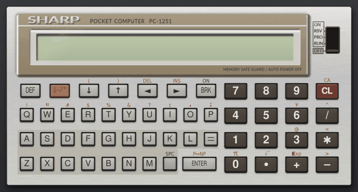
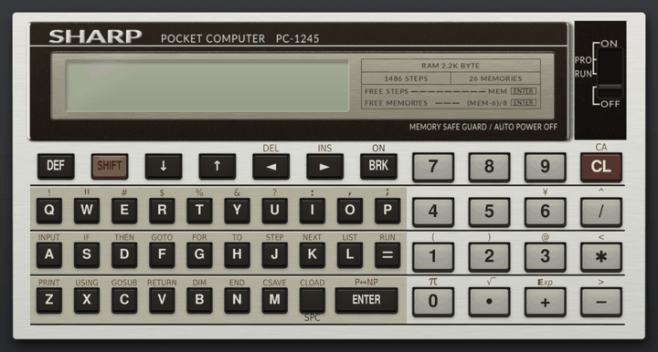
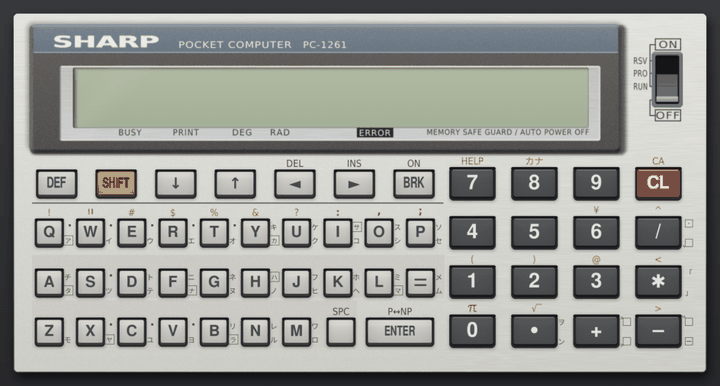
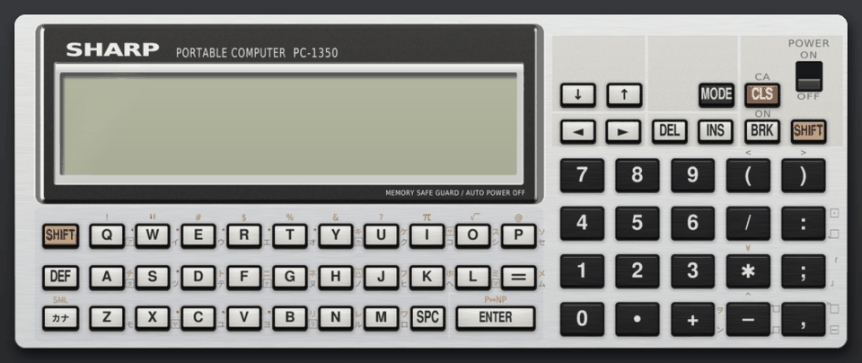
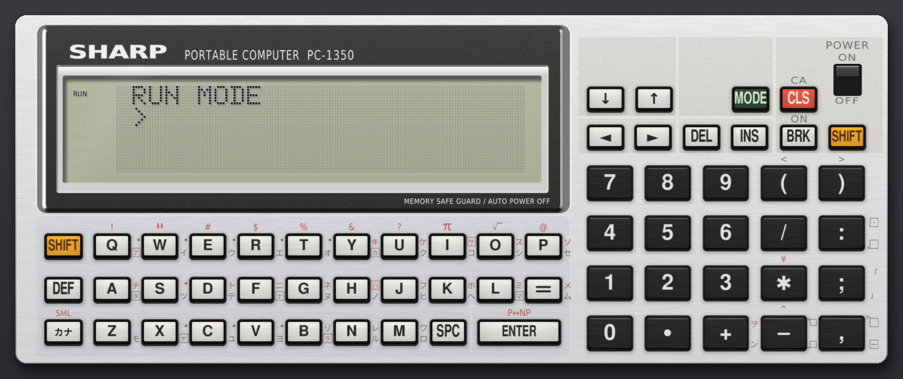

[日本語](README.md) | English

# SHARP PC-1251/PC-1245/PC-1261/PC-1350 emulator

An emulator for four Sharp pocket computers: the PC-1251 (1982), the PC-1245 (1983), the PC-1261 and the PC-1350. It executes the SC61860 CPU one instruction at a time and runs the machine's own internal ROM and BASIC ROM, so BASIC programs and machine code both work. You can press the keys and move the mode switch with the mouse. Even without a ROM you can type in and run machine code (see [Without a ROM](#without-a-rom)). You choose the model when starting; without an option it runs as the PC-1251 (for the PC-1250 and PC-1255, which share its ROM, see [Running as a PC-1250 or PC-1255](#running-as-a-pc-1250-or-pc-1255), for the PC-1245 see [Running as a PC-1245](#running-as-a-pc-1245), for the PC-1261 [Running as a PC-1261](#running-as-a-pc-1261), for the PC-1350 [Running as a PC-1350](#running-as-a-pc-1350)).









The user guide, starting from installation on macOS and Windows, is [`doc/manual.pdf`](doc/manual.pdf) (in Japanese).

## Installing

You need [uv](https://docs.astral.sh/uv/). uv fetches a suitable Python by itself.

```sh
git clone <URL of this repository>
cd pc1251-emulator
mkdir rom                            # put the ROM read from a real machine here (see below)
uv run pc1251                        # start
```

### Preparing the ROM

The ROM is Sharp's copyrighted work, so it is not in this repository. Read it out of a real machine and put it in `rom/` under these names. Only the files for the model you use are needed.

| File | Contents | Size |
| --- | --- | --- |
| `cpu-1251.rom` | PC-1251: the SC61860's internal ROM | 8192 bytes |
| `bas-1251.rom` | PC-1251: the BASIC ROM | 16384 bytes |
| `cpu-1245.rom` | PC-1245: the CPU's internal ROM | 8192 bytes |
| `bas-1245.rom` | PC-1245: the BASIC ROM | 16384 bytes |
| `cpu-1260.rom` | PC-1260/1261/1262: the CPU's internal ROM | 8192 bytes |
| `bas-1260.rom` | PC-1260/1261/1262: the BASIC ROM | 32768 bytes |
| `cpu-1350.rom` | PC-1350: the CPU's internal ROM | 8192 bytes |
| `bas-1350.rom` | PC-1350: the BASIC ROM | 32768 bytes |

For example, if you cloned into `~/src`, the files are `~/src/pc1251-emulator/rom/cpu-1251.rom` and `~/src/pc1251-emulator/rom/bas-1251.rom`.

yagshi's page "[Extracting ROM Data](https://www.oit.ac.jp/rd/labs/kobayashi-lab/~yagshi/old_web/misc/pocketcom/extrom.html)" (in Japanese) describes how to do it on a PC-1251. For the PC-1245, "[SHARP PC-1245/50/51/55 の使い方](https://ht-deko.com/pc1245/)" (ht-deko.com, in Japanese) gives a procedure with BASIC listings that saves the internal ROM 1 KB at a time and the BASIC ROM 4 KB at a time with `CSAVE M`. ROMs come in different versions, so only the file sizes are checked. To keep the ROM elsewhere, set the environment variable `PC1251_ROM` to that folder.

### Without a ROM

The emulator also starts without a ROM (except as a PC-1350). It then runs the CPU, LCD, keys and sound without BASIC or the ROM routines and shows a machine-code workbench to the right of the machine. In the workbench you type in or paste a hex dump listing from a book or magazine, run it, set breakpoints or step one instruction at a time, and watch the registers and memory change. Typed-in code, or a `.hex` file you loaded and edited, can be exported to a `.hex` file. The bundled bouncing ball and Breakout also run without a ROM.

If you have the ROM, `--norom` still starts without it. You can also keep running the ROM, open the workbench with Cmd+D (Ctrl+D) and step through machine code called from BASIC with `CALL`. The workbench is described in the user guide (the section 「マシン語の作業欄」).

## Running

```sh
uv run pc1251 --scale 0.8            # smaller window
uv run pc1251 primes --run           # load the bundled primes.bas and run it
uv run pc1251 ~/prog/game.bas        # load a file by path
uv run pc1251 --fresh                # start without the saved RAM
uv run pc1251 --norom                # run without the ROM, in the machine-code workbench
uv run pc1251 --state ~/.pc1251/state-1251.json  # start from a state saved with Shift+Cmd+S
uv run pc1251 --model 1255           # start as a PC-1255 (1250 also works)
uv run pc1251 --model 1245           # start as a PC-1245
uv run pc1251 --model 1261           # start as a PC-1261 (1260 and 1262 also work)
uv run pc1251 --model 1350           # start as a PC-1350 (--card 16 inserts a 16 KB RAM card)
uv run pc1251 --model 1350 --overseas  # PC-1350 wired as the export model (lowercase letters instead of kana)
uv run pc1251 --lang en              # English screen (--lang ja for Japanese)
uv run pc1251 --help                 # list the options
uv run pc1251 --version              # print the version (please include it in bug reports)
```

On exit the RAM is saved to `~/.pc1251/ram.bin` (`ram-1245.bin` for the PC-1245, `ram-1261.bin` for the PC-1261, `ram-1350.bin` for the PC-1350) and restored at the next start. Without a ROM it goes to a separate file such as `ram-1251-norom.bin`.

### Display language

The screen text can be English or Japanese. Start with `--lang en` (English) or `--lang ja` (Japanese), or set the environment variable `PC1251_LANG` to `en` or `ja`. Without either, the emulator uses the language last chosen with the "日本語" item in the "View & Input" menu ("English" on the Japanese screen); that item switches the language at once and is remembered for the next start.

If no language was ever chosen from the menu, it is decided at start-up: a locale (the environment variables `LC_ALL`, `LC_MESSAGES` and `LANG`) starting with `ja` gives Japanese and any other locale English. Without a locale, the language set in System Settings is used on macOS, and the display language on Windows. If nothing is known, the screen is Japanese. This README quotes the labels of the English screen; things that belong to the machine (key tops, the LCD, BASIC keywords) and the titles of the bundled programs stay as they are.

### Program files

Programs put in `~/.pc1251/programs/` appear in the program list (Cmd+O, or Ctrl+O on Windows). Clicking a row only selects it, even if it is already selected; the buttons at the bottom load it: "Load and run" loads and runs the program (also Enter) and "Load only" only loads it (also Shift+Enter). The file name, the models it runs on and the `# help:` text of the selected row appear below the list. You can also drop a file onto the window. If a file has unreadable lines, a missing or unreadable dump file, a dump that writes outside RAM, BASIC too large for RAM, or a line too long to be typed without losing part of it, nothing is written and a message appears at the bottom of the window. If BASIC that is typed in runs out of room part-way, or a line does not end up as expected, the run command and later dumps are skipped. The state just before loading is kept, and "Undo program load" in the "Machine" menu goes back to it, together with the program name and directives used for exporting. `programs/` has samples: primes, a text animation, a display-during-calculation demo, a machine-code dot-by-dot text scroller, a machine-code bouncing ball, breakout, the PC-Interpreter and a mole-bashing game.

Three kinds of file can be loaded. A `.bas` and a `.hex` with the same name form one program: the dump is written first, then the BASIC goes in.

| Kind | Contents | How it is loaded |
| --- | --- | --- |
| `.bas` | BASIC as plain text | after a `NEW` in PRO mode, tokenized and placed in RAM |
| `.hex` | hex dump, one `address data` line after another | written straight into RAM |
| `.bin` | machine-code bytes only | written at the address given by a `# bin:` line in the `.bas` |

A BASIC program typed in the emulator can be exported with Cmd+E (Ctrl+E on Windows) to `~/.pc1251/programs/` as `name-date.bas`. Machine code is not part of the BASIC export; the machine-code workbench exports it to a `.hex` file with "Export .hex". `uv run pc1251 --export folder` exports from the saved RAM.

#### BASIC files (.bas)

A `.bas` file is not typed: the emulator writes into RAM the same tokenized lines the ROM would make from typing (spaces dropped, keywords as one-byte codes), byte for byte, so even long programs load at once.

- Write the exponent sign (typed with SHIFT+`+`, a different character from the letter E) as `[E]` or `€`, e.g. `1[E]-8`. The letter `E` or `e` is not an exponent (on the PC-1251, `2E-1` means 2×E−1).
- Write π (SHIFT+`0`) as `π`.
- Only 79 characters fit on one input line, but on the real machine a longer line can still be entered by typing part of it, pressing `ENTER`, recalling the line and appending the rest (the edit field of a recalled line holds 79 characters including the line number, a stored keyword counting as one). A line longer than 79 characters is therefore stored as it is if it would go in this way without losing anything. If a line would lose part of it even this way, nothing is written and its line number is shown at the bottom of the window.

Pasted text (Cmd+V) and dropped text files other than `.bas` and `.hex` are not tokenized but typed key by key at eight times the normal speed. Long lines are not split, so anything past 79 characters is lost.

#### Hex dumps (.hex)

Anything after `;` on a line is a comment. Hex dumps written by the YASM61860 assembler (`c300 : 02 41 37 …`) can be used as they are. YASM61860's `-r` output starts at address 0 and is zero-filled up to the ORG, so loading it with `# bin:` would overwrite the BASIC program and variables with zeros; for YASM61860 output use the dump (`-d`) as a `.hex` file.

#### Setting lines

Lines starting with `#` are comments, and can carry these settings.

| Line | Meaning |
| --- | --- |
| `# title: name` | name shown in the list |
| `# run: text` | what to type to run it. Several lines are typed in order, each after the previous command has finished and the ROM is waiting for input again |
| `# mode: PRO` | type the `# run:` text in PRO mode |
| `# help: note` | note shown at the bottom of the window once the program starts. Several lines are stacked |
| `# hex: file` | dump to write first |
| `# bin: file address` | machine-code binary to write first, and its address (`# bin: code.bin &C300`) |
| `# setup: commands` | commands typed in PRO mode after `NEW`, before the BASIC goes in. With this, the dumps are written after `NEW` and these commands |
| `# after: file` | dump to write after the run text is typed. For a `.bin`, add the address: `# after: code.bin &C400` |
| `# norom: note` | note shown when the program is loaded without a ROM. `# norom: off` keeps the program out of the list without a ROM |
| `# data: ranges` | ranges that are data, not code, e.g. `# data: C100-C17F, C200-C20F` (end address included). The workbench disassembly shows them as `DB` rows; ranges you mark as data in the workbench are written here when you export a `.hex` |
| `# model: models` | models it runs on (see [Where to put programs](#where-to-put-programs)) |

- Addresses can be written as `&C300`, `0xC300` or `C300`.
- `# setup:` is for programs that move the BASIC area with `EQU#` and put machine code in the space freed.
- `# after:` is for programs where the BASIC reserves space with `DIM` before the machine code is written.
- A `.hex` that is only used through `# hex:` or `# after:` (with no `.bas` of the same name) is not listed on its own; its size is shown on the program that uses it.

#### Where to put programs

| Runs on | Where |
| --- | --- |
| one model | that model's folder inside the program folder (`pc1251/`, `pc1245/`, `pc1261/`, `pc1350/`) |
| several models | directly in the program folder, with a line such as `# model: 1251,1245` |
| every model (BASIC) | directly in the program folder, without `# model:` |

- Programs in `pc1251/` also appear on the PC-1250 and PC-1255, and those in `pc1261/` on the PC-1260 and PC-1262, if their machine code fits in RAM and does not overlap the BASIC area.
- Files directly in the program folder without `# model:` are taken to work on the models whose RAM or LCD holds every address they load machine code to and every literal `POKE` address. Machine code at C100 means PC-1251 and PC-1245; with neither, every model.
- A program for another model is not listed. Opening it by path reports "(for PC-1251)" and does not load it.
- If a program with the same `# title:` is in the current model's folder, only that one is listed, so a program written separately for each model can sit under the same name in each folder.

### Assembler

`tools/asm61860.py` assembles SC61860 source (`.asm`) into a `.hex` file this emulator can load. Run it in the emulator folder:

```sh
uv run python tools/asm61860.py vline.asm vline.hex
uv run python tools/asm61860.py sprite.asm sprite.hex -D MASK=1   # give a value to a name used in IF
uv run python tools/asm61860.py add.asm add.hex --rom 1251        # use names of ROM routines (FADD, KEYSCAN, ...)
```

One instruction per line; `label:`, `; comment`, `ORG`, `EQU`, `DB` and `IF`/`ELSE`/`ENDIF` are available. Numbers are decimal; write hexadecimal as `&C000` or `0xC000`. `JR`, `JRZ`, `JRNZ`, `JRC` and `JRNC` pick the forward or backward form (`JRP`, `JRM` and so on) from the target. `lo()` and `hi()` take the low and high byte of a 16-bit value. The full syntax is described at the top of the file. Put the `.hex` together with a `.bas` of the same name in `~/.pc1251/programs/` to run it from the program list.

### Keys

Click the keys on screen with the mouse. Letters, digits, symbols, Enter, Space and the arrow keys on your own keyboard work as well. While a key is being delivered to the ROM waiting for input, the calculator runs eight times faster, which reduces dropped keys and display lag when typing fast (auto-repeat of a held key and keys pressed while a program runs keep the real speed).

| macOS | Windows | Machine |
| --- | --- | --- |
| Tab | Tab | SHIFT |
| Option | Alt | DEF |
| delete | Backspace | delete one character |
| fn+delete | Delete | CL |
| Esc | Esc | BRK (ON while the power is off) |
| `\` | `\` | ¥ (there is no backslash on the pocket computer, so `\` in files and pasted text is typed as ¥ too) |
| Cmd+↑, Cmd+↓ | Ctrl+↑, Ctrl+↓ | move the mode switch up or down one step |
| Cmd+O | Ctrl+O | program list |
| Cmd+R | Ctrl+R | the RESET button on the back |
| Cmd+T, Shift+Cmd+T | Ctrl+T, Shift+Ctrl+T | faster / slower (½×, 1×, 2×, 4×, 8×; away from 1× the pitch of the sound changes too) |
| Cmd+E | Ctrl+E | export the BASIC program in memory to a .bas file (while keys go to the workbench, export its dump to a .hex file) |
| Cmd+S | Ctrl+S | save a screenshot |
| Shift+Cmd+S | Shift+Ctrl+S | save the state (save anywhere) |
| Shift+Cmd+L | Shift+Ctrl+L | go back to the saved state |
| Shift+Cmd+R | Shift+Ctrl+R | start recording / stop and save the video |
| Shift+Cmd+P | Shift+Ctrl+P | pause / resume recording |
| Cmd+P | Ctrl+P | pause / resume execution (separate from pausing the recording) |
| Cmd+/ | Ctrl+/ | key help |
| Cmd+V | Ctrl+V | type the clipboard text in (while keys go to the workbench, paste a dump into it) |
| Cmd+K | Ctrl+K | make the arrow keys press 8, 2, 4, 6 on the keypad, or back |
| Cmd+D | Ctrl+D | show or hide the machine-code workbench (with a ROM) |
| Cmd+Z | Ctrl+Z | undo a write in the workbench (Shift+Cmd+Z redoes it) |

On a PC without a numeric keypad, games that use 8, 2, 4 and 6 (up, down, left and right around 5) are easier with Cmd+K (Ctrl+K on Windows, or F7): the arrow keys then press those number keys. Press it again to switch back, or start with `--numpad`.

The "● Record" button at the right end of the bar or Shift+Cmd+R (Shift+Ctrl+R on Windows) starts recording; while recording, the button shows "Recording" with the elapsed time, and pressing it shows "Stop and save recording" and "Pause recording" just above it. Nothing is recorded while paused (also Shift+Cmd+P), and "Resume recording" continues. Stopping saves a 1280×720 MP4 video with sound, showing an enlarged LCD above the whole calculator, as `rec-<date>-<time>.mp4` in the program folder. The ffmpeg used to make the video comes with the imageio-ffmpeg library, which bundles it only for Windows, macOS and Linux (x86_64 and aarch64). Elsewhere the emulator still installs and runs, but recording needs an ffmpeg on the PATH; without one, recording does not start and a warning that ffmpeg was not found appears at the bottom of the window.

Shift+Cmd+S (Shift+Ctrl+S on Windows) saves the RAM, the CPU registers, ports, timers and switch to `~/.pc1251/state-<model>.json` (one per model), and Shift+Cmd+L goes back to it, for example in the middle of a game or to retake a recording. Start with `--state file` to begin from a saved state. Saving again keeps the previous state under the same name with `.bak` added. The export information of the last loaded program (title, `# run:`, `# help:`, dump directives and so on) is saved too and comes back with the state, even if the original file has been edited since. The item "Load state" in the "Machine" menu shows when the state was saved. The tape position and text still being typed from a file are not saved.

Below the calculator is a bar. The buttons "Programs" (list, export, paste), "Machine" (save and load the state, undo loading, switch, RESET), and "View & Input" (key help, arrow keys, screenshot, printout, display language) each open a short menu just above the button. With a menu open, clicking another button of the bar does that button's action, and ← → move to the neighbouring menu. "Pause" pauses execution (it turns into "Resume"), and "Speed" shows the current speed and lets you pick one. The "● Record" button at the right end starts, pauses and stops recording. Hovering over a button shows what it does and its shortcut. Right-click opens a short menu with pausing execution, the program list, screenshot and key help (on the paper, the paper actions). The right end of the bar shows the model, the last loaded program and any setting that differs from the default (arrows as number keys, tape). Turn off Japanese input before typing.

In the program list, click the box at the top or type `/`, then type part of a name to show only the programs that match. The `# help:` text of the loaded program can be shown again with "Help for loaded program" in the "Programs" menu. Esc while a program is being loaded (typed in) stops loading.

### Breakout

`programs/pc1251/break.hex` and `break.bas` are a sideways breakout game written in machine code. Move the paddle with ↑ and ↓, serve with Space, and knock bricks out of the wall creeping in from the right. At the start choose 1 (EASY, three-dot paddle) or 2 (NORMAL, two-dot paddle). Each level has one blinking brick; breaking it releases a second ball, and losing one of the two does not cost a life.

The PC-1245 version is `break.hex` and `break.bas` in `programs/pc1245/`; the list shows one "breakout" entry for whichever model is running. On the PC-1245 the playing field is 75 columns, the score is shown only after the game, and there is no blinking brick (there is not enough memory for it).

### PC-Interpreter and "Reading the PC-Interpreter"

The "PC-Interpreter" from the August 1986 issue of the Japanese magazine PiO (by [Fan_PC-1251](https://x.com/pio1986_10)) runs as well. `programs/pcint.hex` is the article's listing 1 and `programs/mogura.bas` is listing 2, a mole-bashing game; both are included with the author's permission.

Start the game from the program list, then hold down the number key (1–6) of the hole the mole pops out of.

[`doc/pcinterp.pdf`](doc/pcinterp.pdf) is "PC-インタープリタを読む" (Reading the PC-Interpreter, by origuchi), a booklet in Japanese that reads the program instruction by instruction.

### Printer

A printer (a thermal printer that prints 5×7 dot characters) is always connected. When a program prints with `LPRINT` or `LLIST`, a strip of paper comes out below the calculator and feeds a line at a time. On the PC-1251 and PC-1245, pressing SHIFT+ENTER (P↔NP) to show P on the LCD also prints calculations typed by hand.

- Scroll with the mouse wheel over the paper to see earlier lines.
- The printout is saved automatically as a picture of the paper in the program folder as `print-<date>-<time>.png`, rewritten whenever printing pauses for a second. The file location is shown to the left of the paper; click it, or choose "Open printout folder" in the menu, to open the folder.
- The × to the right of the paper, or "Put the paper away" in the "View & Input" menu, puts the paper away. That ends the sheet; the next printout starts a new sheet and a new file.

### Cassette audio (wav)

Programs can be exchanged with a real machine as cassette audio (wav files).

- **Emulator to real machine**: type `CSAVE` or `CSAVE M` in RUN mode. The sound the ROM sends to the cassette port is written to the program folder (`~/.pc1251/programs`) as `tape-<date>-<time>.wav`. Play the wav into the real machine's cassette interface and type `CLOAD`/`CLOAD M` on the real machine. `BEEP` sounds are not written.
- **Real machine to emulator**: record the real machine's `CSAVE` as a wav, drop it onto the window (or start with `--tape file`) to insert it as a tape, then load it with `CLOAD`/`CLOAD M`.

Machine-code wavs made with PocketTools' `bin2wav` or YASM61860's `-w` (with `-old`) load with `CLOAD M`.

## Running as a PC-1250 or PC-1255

`--model 1250` and `--model 1255` start the emulator as a PC-1250 or PC-1255. Both use the same ROM as the PC-1251 and differ only in RAM size, so they run the PC-1251's `cpu-1251.rom` and `bas-1251.rom`.

| Model | RAM | Free for programs (`MEM`) |
| --- | --- | --- |
| PC-1250 | 2 KB | 1438 bytes |
| PC-1251 | 4 KB | 3486 bytes |
| PC-1255 | 10 KB | 9630 bytes |

The program list shows the PC-1251 programs that fit in RAM. The PC-1250's RAM is small, so Breakout and some others are not listed. RAM is saved to `~/.pc1251/ram-1250.bin` and `ram-1255.bin`.

The case is the PC-1251 picture with only the printed model name changed; differences in the real cases (colours, printing, details of the shape) are not reproduced.

## Running as a PC-1245

With `--model 1245` the emulator starts as a PC-1245. The PC-1245 has the same case size as the PC-1250/1251 and the same SC61860 CPU, but a different ROM. Put its ROM in `rom/` as `cpu-1245.rom` and `bas-1245.rom` (see [Preparing the ROM](#preparing-the-rom)).

```sh
uv run pc1251 --model 1245
uv run pc1251 --model 1245 primes --run
```

The program list, exporting, shortcuts and running programs with DEF work as on the PC-1251. The differences are:

- The LCD has 16 characters. Anything written to the right of the 16th is not visible, so some PC-1251 programs show only part of their display.
- The breakout sample loads its PC-1245 version (`programs/pc1245/`): a 75-column playing field, the score shown only after the game, and no blinking brick.
- RAM is 2 KB, and 1486 bytes are free for programs (the value of `MEM`).
- The mode switch has three positions, PRO, RUN and OFF; there is no RSV. Cmd+↑↓ (Ctrl+↑↓) and the "Machine" menu move only between those three.
- On the A–= and Z–SPC rows, SHIFT followed by a key enters the BASIC keyword printed above it (INPUT, IF, THEN, …, PRINT, USING, …, CLOAD).
- Parentheses are SHIFT+1 and SHIFT+2 (↓ and ↑ on the PC-1251). Typing `(` or `)` on the PC keyboard is translated into these.
- RAM is saved to `~/.pc1251/ram-1245.bin` on exit, separately from the PC-1251's `ram.bin`.

Apart from DEG, which is visible in the photos, the positions of the LCD annunciators are estimates.

## Running as a PC-1261

With `--model 1261` the emulator starts as a PC-1261, a model with a two-line, 24-column LCD and a ROM different from the PC-1251's. Put its ROM in `rom/` as `cpu-1260.rom` and `bas-1260.rom` (see [Preparing the ROM](#preparing-the-rom)). The PC-1260 and PC-1262 use the same ROM and differ only in RAM size, so `--model 1260` and `--model 1262` use the same files.

```sh
uv run pc1251 --model 1261
uv run pc1251 --model 1261 ball --run     # the bouncing ball sample
uv run pc1251 --model 1261 hello --run    # load and run the sample hello.bas
uv run pc1251 --model 1261 lc3-block --run   # compile a breakout game with the LC-3 compiler and play
```

The program list, export, shortcuts, DEF-key execution and cassette audio work as on the PC-1251. The differences:

- The LCD has two lines of 24 characters. Short LCD bars light above the printed labels BUSY, PRINT, DEG, RAD and ERROR below the display, and カナ (kana), SMALL, SHIFT and DEF sit at the left edge of the LCD from top to bottom. カナ lights in katakana input mode. SMALL marks lowercase input: after `POKE &203C,PEEK &203C AND &7F` in RUN mode, SHIFT+8 toggles lowercase instead of katakana and SMALL lights (turning the power off and on restores katakana). The LCD has no segment for GRAD.
- The parentheses are SHIFT+1 and SHIFT+2, and ¥ is SHIFT+6. There is no Exp key, so write exponents with the letter E (`1E3`). Typing `(`, `)` or `¥` on the PC is converted to those key strokes.
- SHIFT+8 (カナ) switches to katakana input. Each key then enters the kana printed at its lower right, and with SHIFT the one at its upper right; keys marked with a dot give small kana (ァ, ッ and so on) with SHIFT. Kana typed or pasted on the PC (full-width, half-width or hiragana) are entered by switching to kana input and back afterwards; voiced marks become ゛ (SHIFT+−) and ゜ (SHIFT++) after the kana.
- RAM is 10 KB, with 9342 bytes free (`MEM`). The PC-1260 has 4 KB with 3198 bytes free.
- The CPU runs 4/3 as fast as the PC-1251. The ROM needs a longer gap between key strokes, so pasted text is typed at about 0.22 seconds per key stroke. A BASIC program loaded from a file goes in at once, as on the other models.
- Machine-code samples for the PC-1251 (the PC-Interpreter, the mole game, `noise.bas`) are not listed. PC-1261 samples are in `programs/pc1261/`; those that fit in RAM also work on the PC-1260 and PC-1262 (the PC-1260 has too little RAM for LC-3 and its samples). `ball` is machine code in which a ball bounces across both LCD lines while moving right.
- The LC-3 compiler (by COR, Pocket Computer Journal, June 1989) is included as `programs/pc1261/lc3.hex`. It compiles a game-oriented language with one-byte integers, whose source is typed in as a BASIC program, into machine code. Choosing "LC-3コンパイラ" in the list writes the compiler and moves the BASIC area out of its way. Then type the source in PRO mode, compile it with `CALL &4000` and run it with `CALL &4900`. Three samples from the article (`lc3-hello`, `lc3-move`, `lc3-chars`) and a breakout game written for this emulator (`lc3-block`) compile and run as soon as they are chosen. In the breakout game, move the paddle on the left edge with 8 (up) and 2 (down) to hit the ball back and clear the 40 bricks on the right. Hitting with an end of the paddle sends the ball off diagonally, hitting with the middle sends it straight. There are three balls; when all bricks are gone or no ball is left, the score is shown and a key press starts again. The compiler is `LC-3.bin` from [hiroog/LC3_Compiler](https://github.com/hiroog/LC3_Compiler) (see [Rights](#rights)).
- RAM is saved to `~/.pc1251/ram-1261.bin` (`ram-1260.bin`, `ram-1262.bin`).

The case picture is drawn from photographs of the PC-1260 and PC-1261. The PC-1260 and PC-1262 use the same picture with only the printed model name changed; differences in their real cases (colours, printing, details of the shape) are not reproduced.

## Running as a PC-1350

With `--model 1350` the emulator starts as a PC-1350, a model with a 150×32 dot LCD (4 lines of 24 characters). Put its ROM in `rom/` as `cpu-1350.rom` and `bas-1350.rom` (see [Preparing the ROM](#preparing-the-rom)). It was tested with the Japanese ROM, which can type katakana.

```sh
uv run pc1251 --model 1350
uv run pc1251 --model 1350 --card 16      # start with a 16 KB RAM card (CE-202M)
uv run pc1251 --model 1350 hello --run    # load and run the sample hello.bas
uv run pc1251 --model 1350 ball --run     # the bouncing ball sample
```

The program list, export, shortcuts, DEF keys and cassette audio (wav) work as on the PC-1251. The differences are:

- There is no mode switch. RUN and PRO are toggled with the MODE key. F1 selects RUN mode and F2 PRO mode (pressing MODE if the current mode differs). The switch at the top right is the power switch; move it with the mouse or with F3 (ON) and F4 (OFF). Programs survive switching off. The ON key (BRK) does not switch on while the switch is OFF.
- The annunciators RUN, PRO, カナ, SML, SHIFT and DEF are arranged vertically at the left edge of the LCD.
- The keys follow the PC-1350 layout. Parentheses, `/`, `:`, `;` and `,` are on the numeric side and need no SHIFT; `<`, `>`, `¥` and `^` are SHIFT plus a numeric-side key. Symbols typed on the computer are converted to these key sequences. Delete is DEL, Insert is INS, Home is CLS, and Backspace deletes one character with ◀ and DEL.
- The カナ key (F8 on the computer) switches to katakana input and SHIFT+カナ to lower-case input (SML). Katakana typed or pasted on the computer (full-width, half-width or hiragana) is typed in katakana input, switching back afterwards. In program files, lower-case letters inside `"` strings are typed as they are, switching to SML; everything else is upper-cased (keywords must be upper case).
- RAM is the built-in 4 KB, leaving 3070 bytes for programs (the value of `MEM`). `--card 8` and `--card 16` insert an 8 KB or 16 KB RAM card, leaving 11262 or 19454 bytes.
- The CPU runs at the same speed as the PC-1261. The ROM needs a long gap between key strokes, so pasted text is typed at about 0.25 s per keystroke. A BASIC program loaded from a file goes in at once, as on the other models.
- Machine-code samples for the PC-1251 are not listed. PC-1350 samples are in `programs/pc1350/`. `ball` is machine code in which a ball bounces between the bottom and the top of the LCD while moving right, squashing with a thud each time it lands.
- RAM is saved to `~/.pc1251/ram-1350.bin` (with a card, a name including its size such as `ram-1350-16k.bin`).



The case picture is drawn from a photograph of the PC-1350 taken from directly above, and is wider than the PC-1251 picture.

## Differences from the real machine

- Cassette input has been checked with recordings of real tapes (they load with `CLOAD`). The wavs the emulator writes have not been played into a real machine yet.
- The printer uses the calculator ROM's character shapes in place of the printer's own; printing speed and the paper feed key are not reproduced.
- Different ROM versions have not been checked.
- BASIC's `PEEK` can read the internal ROM here (according to the documentation, on the real machine only the `DATA` instruction can read it).

The memory map, I/O ports and LCD RAM layout are summarized in an appendix of the manual ([`doc/manual.pdf`](doc/manual.pdf), in Japanese).

## Tests

```sh
uv run pytest -q tests
```

Tests that need the ROM are skipped when it isn't there. The PC-1245 tests (`tests/test_pc1245.py`) need `rom/cpu-1245.rom` and `rom/bas-1245.rom`, and the PC-1261 tests (`tests/test_pc1261.py`) need `rom/cpu-1260.rom` and `rom/bas-1260.rom`, and the PC-1350 tests (`tests/test_pc1350.py`) need `rom/cpu-1350.rom` and `rom/bas-1350.rom`.

## Development

This emulator was made with the help of Anthropic's Claude.

## Acknowledgements

This emulator was written with reference to the following emulators. Many thanks to their authors.

- [MAME](https://github.com/mamedev/mame)
- [PockEmul](https://github.com/paulie-g/PockEmul)
- [PokecomGO](https://github.com/digihori/pokecom)
- [Pokecom GO Plus](https://github.com/digihori/pokecom-go-plus)

## Rights

The emulator's code and artwork are released under the MIT License ([LICENSE](LICENSE)). `lc3.hex` (the LC-3 compiler) and the article sources among the `lc3-` samples in `programs/pc1261/` (`lc3-hello`, `lc3-move`, `lc3-chars`) are works by LC-3's author COR (hiroog on GitHub) and are not covered by the MIT License. They are included under the author's statement in his [blog post of 3 January 2018](https://wlog.flatlib.jp/archive/1/2018-1-3) that LC-3 may be distributed freely and that dump lists, binaries and the like may be published as anyone likes.

SHARP is a trademark of Sharp Corporation. This is an unofficial emulator made by an individual and has no connection with Sharp Corporation.
